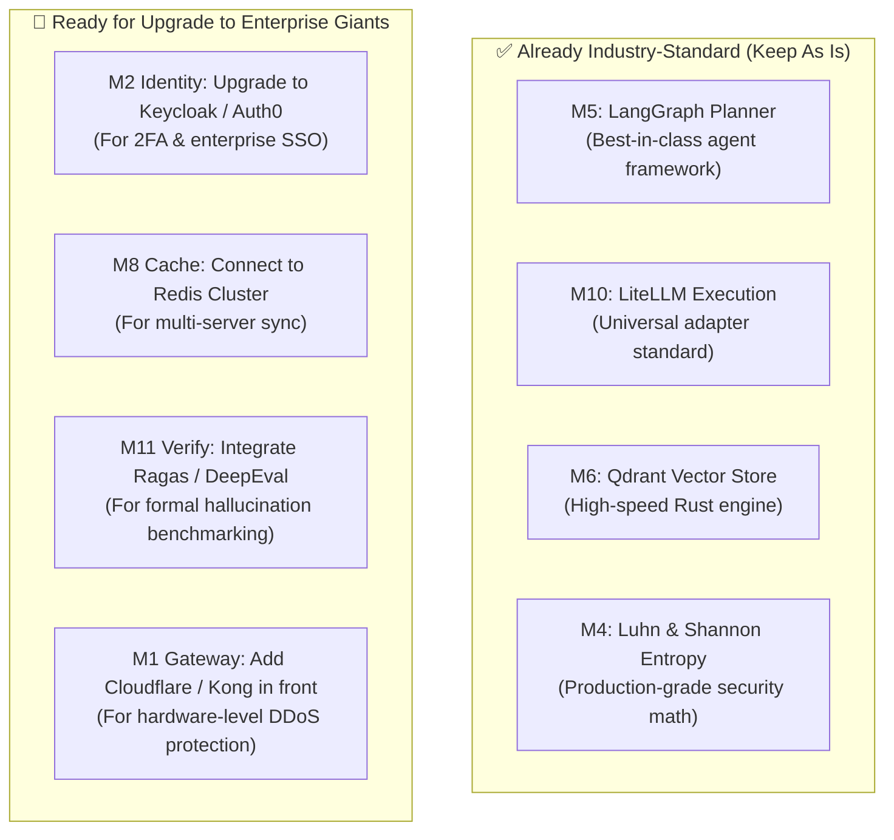

# 📖 Complete Beginner's Guide: Understanding EDITH-X from Scratch
> **Analyzed via `explain-codebase` (Zero-Installation Static Analysis)**  
> *Written in plain, everyday English with zero confusing jargon.*

---

## 1. What is this Entire Project in Simple Words?

Imagine your company employs hundreds of people who use AI (like ChatGPT or Claude) for their daily work. Every time an employee asks ChatGPT a question, OpenAI sends your company a bill. At the end of the month, the bill is **$50,000 to $100,000+**.

Even worse:
- An employee might accidentally paste a customer's **credit card or password** into ChatGPT.
- 50 different employees might ask the **exact same question** ("What is our travel reimbursement policy?"), and the company pays 50 separate times for the exact same answer.
- If OpenAI has an outage, your entire company's workflow grinds to a halt.

**EDITH-X is an "AI Operating Manager" (Middleware) that sits between your company's apps and AI providers.**
Instead of your apps talking directly to OpenAI, they talk to **EDITH-X**. EDITH-X checks for secrets, sees if the question was already answered for free, picks the cheapest model that is smart enough, and protects you from outages.

---

## 2. Findings from `explain-codebase`

Running the `explain-codebase` static analysis engine directly on `EDITH_X-master` revealed the following structure:

```text
Repository Type:       Python Backend / CLI Runtime
Total Tracked Files:   80 files
Entrypoints (Starts):  4 (cli/main.py, rest/app.py, run_enterprise_simulation.py, seed_dummy_company.py)
Core Modules:          edith_x/core/interfaces.py, config.py, policy/firewall.py
Side-Effect Modules:   demo/ui.py, interfaces/cli/main.py, seed_dummy_company.py
Key Architecture Note: edith_x/core/interfaces.py is the central contract imported by 18 modules.
```

---

## 3. The 10 "Scary" Words in This Project Explained Like You're 10

| Term | What People Call It | What It Actually Means in Plain English |
|---|---|---|
| **Middleware** | "Software layer in the middle" | A traffic guard that catches messages between your browser and the server to inspect or clean them before letting them through. |
| **Token** | "AI currency" | A piece of a word. ~4 letters = 1 token. AI companies don't charge by the second; they charge by how many tokens (words) you read and write. |
| **Semantic Cache** | "Smart memory clipboard" | Standard cache only matches exact words. A *semantic* cache knows that *"What is the capital of France?"* and *"Tell me France's capital city"* mean the exact same thing. |
| **Cosine Similarity** | "Math angle of meaning" | A math formula giving a score from 0.0 to 1.0 on how close two ideas are. If score ≥ 0.92, they mean the same thing. |
| **PII (Personally Identifiable Info)** | "Private human data" | Credit cards, Social Security numbers, phone numbers, and passwords that get you sued or fined if leaked. |
| **Circuit Breaker** | "Fuse box" | Just like your home's electrical fuse box trips when there's a surge to prevent a fire, a software circuit breaker stops sending traffic to an AI provider if that provider starts crashing. |
| **Pareto Router** | "Smart dispatcher" | A computer program that decides: *"Can the cheap $0 scooter do this delivery, or do we need the $100 helicopter?"* |
| **RAG (Retrieval-Augmented Generation)** | "Open-book test" | Instead of the AI guessing from memory, you feed it your company's private PDF handbooks so it reads the facts before answering. |
| **Vector Database** | "Meaning library" | A database (like Qdrant) that stores sentences as mathematical coordinate points so similar ideas sit next to each other on a digital map. |
| **LangGraph DAG** | "Step-by-step flowchart" | A system that lets the AI take multiple steps: Step 1 (Search) → Step 2 (Read) → Step 3 (Write) → Step 4 (Self-Check). |

---

## 4. Module-by-Module Breakdown: Inner Terms, Why It's Used & Better Alternatives

Let's break down all 14 modules, explaining:
1. **What it does**
2. **Inner terms explained**
3. **Why it's used**
4. **Alternative tools that exist**
5. **Which is better and why**

---

### Module 1: M1 — Gateway (`edith_x/modules/gateway`)

* **What it does:** The front door of EDITH-X. It accepts incoming web requests from your apps, checks if the user has an API key, and stops them if they are spamming too many requests.
* **Inner Terms Explained:**
  * `Sliding Window Rate Limiter`: Imagine a timer counting how many times you clicked in the last 60 seconds. If you clicked 1,001 times and your limit is 1,000, it blocks you for a few seconds.
  * `FastAPI`: A modern Python framework for building super-fast web address endpoints.
* **Why it's used:** Without this, anyone could crash your server by sending 100,000 queries per second, running up a million-dollar bill.
* **Alternatives:** Kong Gateway, Traefik, NGINX, Cloudflare API Gateway.
* **Which is better?**
  * **For right now:** FastAPI (what EDITH-X uses) is lightweight and lives right in Python.
  * **For large enterprise (10,000+ users):** **Kong or Cloudflare** is better because they handle rate-limiting at the network hardware level before Python even has to wake up.

---

### Module 2: M2 — Identity & Multi-Tenancy (`edith_x/modules/identity`)

* **What it does:** Figures out *who* is calling. Are you John from Company A (Enterprise plan) or Bob from Company B (Free plan)?
* **Inner Terms Explained:**
  * `HMAC constant-time comparison`: When checking passwords, normal computers stop checking the moment a letter doesn't match. Hackers can measure this nanosecond time difference to guess passwords ("Timing Attack"). Constant-time checking always takes the exact same time no matter what.
  * `RBAC (Role-Based Access Control)`: Giving Admins the ability to change settings, while regular Viewers can only ask questions.
* **Why it's used:** Keeps different companies using the same server from ever seeing each other's data.
* **Alternatives:** Auth0, Clerk, Keycloak, AWS Cognito.
* **Which is better?**
  * **Clerk / Auth0** is better for commercial SaaS because they handle password resets, Two-Factor Authentication (2FA), and Google/Microsoft enterprise SSO out of the box. EDITH-X's custom code is good for prototypes, but using **Keycloak or Auth0** is safer for production.

---

### Module 3: M3 — Intent Engine (`edith_x/modules/intent`)

* **What it does:** Reads your sentence in under 2 milliseconds and figures out what category it belongs to (a casual greeting, a Python code request, a financial calculation, or a database command).
* **Inner Terms Explained:**
  * `Centroid`: Think of it as a "bullseye center". The system has a bullseye for "coding words" and a bullseye for "simple words". It checks which bullseye your sentence lands closest to.
  * `Complexity score (0.0 to 1.0)`: 0.1 means "Hello", 0.95 means "Write a quantum physics equation in C++".
* **Why it's used:** It's super fast (takes less than 2 milliseconds) and costs **$0.00**. You don't want to call a slow, expensive AI model just to figure out what kind of question was asked.
* **Alternatives:** Calling GPT-4o-mini to classify, SpaCy text classification, FastText.
* **Which is better?**
  * **EDITH-X's Centroid Router** is better for latency (0.5ms vs 500ms for GPT-4o-mini). However, adding **FastText** (an open-source Facebook model) would give higher accuracy without adding latency.

---

### Module 4: M4 — Policy & PII Firewall (`edith_x/modules/policy`)

* **What it does:** The airport security scanner. It looks at your prompt and scrubs out Credit Cards, Social Security Numbers, and Passwords before sending the prompt to the cloud.
* **Inner Terms Explained:**
  * `Luhn Algorithm`: A mathematical formula invented by IBM that checks if a 16-digit number is an actual credit card or just a random number.
  * `Shannon Entropy`: A math formula that measures "randomness". English words have low randomness ("apple"). Passwords and API keys have extreme randomness (`sk-9f8a2b3c4d5e...`). If randomness is above 3.8 bits, it flags it as a secret password!
* **Why it's used:** Violating credit card (PCI-DSS) or health (HIPAA) laws brings millions of dollars in government fines.
* **Alternatives:** Microsoft Presidio, AWS Comprehend, Nightfall AI.
* **Which is better?**
  * **Microsoft Presidio** combined with EDITH-X's regex is the gold standard. Presidio uses AI to spot human names and medical conditions that regular math formulas miss.

---

### Module 5: M5 — Planner (`edith_x/modules/planner`)

* **What it does:** When you give EDITH-X a hard multi-step goal (like *"Analyze our Q3 sales and summarize risks"*), this module acts as the project manager, breaking the goal into steps.
* **Inner Terms Explained:**
  * `LangGraph`: A Python tool created by LangChain that lets an AI run in loops. If it makes a mistake, it can loop back and try again.
  * `DAG (Directed Acyclic Graph)`: A fancy name for a flowchart that moves forward along arrows without getting stuck in an infinite loop.
* **Why it's used:** One-shot AI answers often hallucinate. Breaking work into "Search → Draft → Verify → Refine" produces 10x higher quality.
* **Alternatives:** AutoGPT, CrewAI, Microsoft AutoGen, LlamaIndex Workflows.
* **Which is better?**
  * **LangGraph (what EDITH-X uses) is currently the industry best** for complex production agents because it gives complete developer control over state and loops. CrewAI is easier to write, but LangGraph is much more stable in enterprise software.

---

### Module 6: M6 — Knowledge Base (`edith_x/modules/knowledge`)

* **What it does:** Connects your company's private documents (PDFs, Notion pages, policies) so the AI can read them before answering.
* **Inner Terms Explained:**
  * `Dense Vector Retrieval`: Converting text into a list of 1,536 numbers that capture its meaning.
  * `BM25 Keyword Search`: Searching for exact word matches (like Ctrl+F in Google).
  * `Qdrant`: An ultra-fast, open-source database built specifically to search through vector numbers.
* **Why it's used:** General AI models know nothing about your company's internal vacation policy or private source code.
* **Alternatives:** Pinecone, Milvus, Weaviate, ChromaDB, pgvector.
* **Which is better?**
  * **Qdrant (used here) is top-tier** because it is written in Rust, blazingly fast, and can run on your own servers for free. **pgvector (Postgres)** is also great if a company already runs PostgreSQL and doesn't want to manage a separate vector database.

---

### Module 7: M7 — Context Builder (`edith_x/modules/context`)

* **What it does:** Takes all the search results from the Knowledge Base and your chat history, and trims them down so they fit within your token budget without exceeding limits.
* **Inner Terms Explained:**
  * `Token Budget`: AI models have a limit on how much text they can read at once (e.g. 6,000 tokens). If you send too much, it errors out or charges you double.
  * `Deduplication`: Removing repeated paragraphs so you don't waste money sending the same text twice.
* **Why it's used:** Prevents "Out of Memory / Context Window Exceeded" errors and keeps API costs predictable.
* **Alternatives:** LangChain Context Compressor, LlamaIndex Node Parsers.
* **Which is better?**
  * EDITH-X's custom context builder is clean. Adding **LlamaIndex** would make parsing PDFs and tables much easier.

---

### Module 8: M8 — Optimization & L0 Semantic Cache (`edith_x/modules/optimization`)

* **What it does:** Saves answers in a digital memory filing cabinet. If another person asks the same question, it hands back the saved answer in **under 20 milliseconds for $0.00**.
* **Inner Terms Explained:**
  * `LRU (Least Recently Used)`: If the memory box can hold 10,000 questions and gets full, it automatically deletes the oldest question that nobody has asked in a long time.
  * `Inverted Index`: A book index at the back of a textbook that lets you instantly find which page a word appears on without reading the whole book.
* **Why it's used:** In customer support and enterprise intranets, **20% to 40% of questions are identical repeats**. Answering them for $0 saves thousands of dollars every week.
* **Alternatives:** GPTCache, Redis Semantic Cache, Momento.
* **Which is better?**
  * **Redis Semantic Cache** is better for multi-server clusters because it shares the memory across all servers. EDITH-X's in-memory cache is great for single servers, and it already has an adapter designed to connect to Redis!

---

### Module 9: M9 — Pareto Model Router (`edith_x/modules/router`)

* **What it does:** The "brain" of cost savings. It decides which of the 4 layers should answer your prompt:
  * **L0:** Cache ($0.00)
  * **L1:** Free local model on your company computer ($0.00)
  * **L2:** NVIDIA NIM medium cloud model ($0.0008)
  * **L3:** Frontier supercomputer GPT-4o ($0.0025+)
* **Inner Terms Explained:**
  * `Pareto Principle (80/20 Rule)`: 80% of tasks can be solved by simple, cheap tools; only 20% actually need an expensive genius.
  * `Sigmoid Clamping`: A mathematical S-curve formula that squashes any number into a clean probability between 0% and 100%.
* **Why it's used:** Most people use GPT-4o for tasks like *"Fix my spelling"* or *"Translate this to Spanish"*. That's like paying an astronaut to change a lightbulb.
* **Alternatives:** RouteLLM (by LMSYS / UC Berkeley), Martian Model Router, Foyle.
* **Which is better?**
  * **RouteLLM** is currently the academic benchmark leader because it is trained on 100,000 real human preference battles. EDITH-X's router is based on similar ideas and is super lightweight.

---

### Module 10: M10 — Execution & Waterfall (`edith_x/modules/execution`)

* **What it does:** Actually calls the AI model over the internet. If the first choice (like OpenAI) is down or gives a "429 Rate Limit", it automatically cascades down the waterfall to Groq, Anthropic, or your local machine without the user noticing an error.
* **Inner Terms Explained:**
  * `LiteLLM`: A universal adapter library. It lets you write code once, and it works with OpenAI, Anthropic, Google Gemini, Ollama, Groq, and 100+ other models.
  * `HTTP 429`: An internet error code meaning *"You are sending too many requests too fast; slow down!"*
  * `Failover`: Automatically switching to a backup generator when the main power grid goes black.
* **Why it's used:** Zero downtime. If OpenAI goes down during business hours, your company's app keeps running on backup models.
* **Alternatives:** LangChain ChatModels, Portkey Gateway, OpenRouter.
* **Which is better?**
  * **LiteLLM (used here) is the undisputed open-source standard.** It is maintained by thousands of developers and updated within hours whenever a new model launches.

---

### Module 11: M11 — Verification (`edith_x/modules/verification`)

* **What it does:** Fact-checker. It checks if the AI made up facts (hallucinated) or if its answer matches the facts in the company documents.
* **Inner Terms Explained:**
  * `Grounding`: Checking if an answer can be traced back to an actual paragraph in your real company document.
  * `Hallucination`: When an AI sounds confident but completely invents a fake fact.
* **Why it's used:** Prevents embarrassing mistakes, legal liability, or false financial advice.
* **Alternatives:** Ragas, TruLens, DeepEval, Cleanlab.
* **Which is better?**
  * **Ragas and DeepEval** are the industry leaders for enterprise grading. Integrating Ragas into EDITH-X's M11 would make it production-ready.

---

### Module 12: M12 — Reflection Loop (`edith_x/modules/reflection`)

* **What it does:** If Module 11 (Verification) says *"Hey, this answer is low quality or incomplete"*, Module 12 says: *"Don't show it to the user yet. Send it back to the planner, fetch better documents, and try one more time."*
* **Inner Terms Explained:**
  * `Self-Correction / Reflection`: Teaching an AI to critique its own work before publishing it.
* **Why it's used:** It elevates response accuracy from ~70% on the first try to >90% on the second try.
* **Alternatives:** Reflexion architecture, LangGraph Human-in-the-loop.
* **Which is better?**
  * LangGraph reflection (used in EDITH-X) is the modern standard.

---

### Module 13: M13 — Hierarchical Memory (`edith_x/modules/memory`)

* **What it does:** Remembers preferences across conversations.
  * User-level: *"John likes concise bullet points."*
  * Team-level: *"The marketing team uses AP style guide."*
  * Org-level: *"Company fiscal year starts in April."*
* **Inner Terms Explained:**
  * `Mem0`: An open-source long-term memory engine for AI that automatically extracts and stores personal facts.
* **Why it's used:** Without memory, every new conversation starts with amnesia.
* **Alternatives:** Zep, LangChain ConversationBufferMemory, MemGPT (Letta).
* **Which is better?**
  * **Mem0 (used here) and Zep are the two best long-term memory systems** in the AI ecosystem today. Mem0 is very lightweight and easy to self-host.

---

### Module 14: M14 — Observability & Cost Ledger (`edith_x/modules/observability`)

* **What it does:** The financial accountant. It tracks every single prompt, counts input and output tokens, calculates exact compute costs, and calculates how many dollars you saved compared to calling GPT-4o.
* **Inner Terms Explained:**
  * `Prometheus`: The worldwide standard software used by DevOps engineers to collect performance graphs and server statistics.
  * `Grafana`: A dashboard tool that turns Prometheus numbers into pretty charts and graphs on TV screens in company monitoring rooms.
* **Why it's used:** When the CFO asks *"Why did we spend money on EDITH-X?"*, you can show a chart proving: *"EDITH-X cost us $500, but it saved us $42,000 this month."*
* **Alternatives:** LangSmith, Helicone, Portkey, Arize Phoenix.
* **Which is better?**
  * **For pure billing & Prometheus: EDITH-X's approach is great.**
  * **For deep debugging: Helicone or Arize Phoenix** are fantastic because they let you click on any user request and see the exact prompt timeline.

---

## 5. Summary Scorecard: What to Keep vs. What to Upgrade



---

*This guide was generated directly using static code heuristics from `explain-codebase` without installing any packages.*
