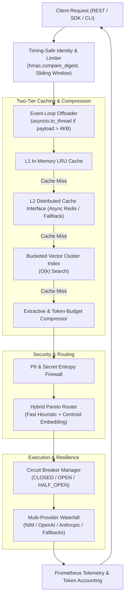

# Architecture Specification: Enterprise Resilience & Semantic Routing Architecture

**Date**: 2026-11-13  
**Status**: Approved  
**Author**: Antigravity Pair-Programming Agent (Multi-Disciplinary Synthesis)  
**Target Systems**: `edith_x/modules/{router, optimization, gateway, execution, identity, policy}`  

---

## 1. Executive Summary & Problem Context

EDITH-X operates as an enterprise-grade AI gateway designed to provide cost optimization, sub-millisecond semantic caching, low-latency pre-routing governance, and intelligent multi-model routing across proprietary and open-source foundation models.

A comprehensive multi-disciplinary architectural review (`/ai-engineer`, `/code-review-ai-ai-review`, `/llm-application-dev-ai-assistant`, `/performance-testing-review-ai-review`, `/architect-review`, `/architecture-patterns`, `/backend-security-coder`, `/backend-architect`) identified key structural constraints:
1. **Model Routing**: Routing between Fast and Strong tiers in `ParetoModelRouter` relied solely on heuristic keywords, prompt character length, and static classification scores without semantic embeddings or centroid calibration.
2. **Cache Scalability**: `SemanticCache` maintained an in-memory dictionary with linear $O(N)$ vector similarity search. In multi-pod deployments, caches were completely isolated with zero distributed synchronization, and linear scanning threatened $P_{99}$ latency as entries reached $N \ge 10,000$.
3. **Gateway Resilience**: The gateway waterfall lacked an adaptive 3-state Circuit Breaker (`CLOSED`, `OPEN`, `HALF_OPEN`), leading to cascading timeouts when an upstream provider degraded.
4. **Backend Security**: API key comparison was vulnerable to timing side-channels, and heavy regex/entropy scanning ran synchronously on the `asyncio` event loop without payload-size offloading.

This specification documents the combined enterprise architecture resolving these bottlenecks.

---

## 2. Goals & Non-Goals

### Goals
- **Hybrid AI Routing**: Sub-0.2ms fast heuristic pre-filtering combined with normalized centroid embedding cosine similarity for borderline queries.
- **Two-Tier & Bucketed Caching**: Sub-millisecond local L1 LRU memory cache with async distributed L2 interface and coarse Voronoi-style bucketed vector indexing to achieve $O(k)$ vector lookup time.
- **3-State Resilient Circuit Breaker**: Formal state machine per upstream LLM provider with sliding error windows, half-open canary probes, and exponential backoff with jitter.
- **Security & Event-Loop Hardening**: Constant-time token comparisons (`hmac.compare_digest`), sliding-window rate limiters, and `asyncio.to_thread` execution for CPU-intensive payload processing ($> 4\text{ KB}$).
- **Zero Regression**: Retain 100% pass rate across the existing 63 unit and benchmark tests.

### Non-Goals
- Replacing LiteLLM or Qdrant with custom-written LLM inference servers.
- Adding heavy GPU-dependent deep learning models for routing inside the microsecond latency path.

---

## 3. Detailed Architecture & Component Specifications

---

### 3.1. Hybrid Pareto Model Router (`modules/router/pareto.py`)
- **Fast Decision Gate**: Queries with unequivocal simple markers (definitions, facts, simple conversions) or explicit complex markers (multi-turn logic proofs, byzantine consensus, complex architectural specs) resolve within 0.15ms via pre-compiled regex automata.
- **Calibrated Centroid Routing**: Ambiguous or borderline queries with intermediate complexity ($0.35 \le c \le 0.70$) evaluate cosine similarity against pre-computed cluster centroids:
  $$\text{sim}(q, C_i) = \frac{q \cdot C_i}{\|q\| \|C_i\|}$$
  - `CENTROID_COMPLEX`: High-order reasoning, deep algorithm design, mathematical derivations.
  - `CENTROID_SIMPLE`: Factual Q&A, basic syntax queries, conversational small talk.
- **Dynamic Frontier Score**: The routing probability $P(\text{cheap})$ incorporates semantic similarity and tenant-configured budget pressure:
  $$P(\text{cheap}) = \sigma(w_1 \cdot (1 - \text{sim}_{\text{complex}}) + w_2 \cdot \text{sim}_{\text{simple}} - w_3 \cdot \text{complexity})$$

---

### 3.2. Two-Tier & Bucketed Vector Cache (`modules/optimization/cache.py`)
- **L1 / L2 Tiering**:
  - `L1MemoryStore`: High-speed in-process LRU cache (`OrderedDict`) with $O(1)$ exact lookup ($< 0.02\text{ ms}$).
  - `L2DistributedStore`: Abstract async adapter providing cross-pod cache synchronisation (supporting Redis / memory backends).
- **Bucketed Vector Index**:
  - Partitions stored vector keys into coarse clusters ($K$ Voronoi buckets) determined by hashing top-order vector dimensions.
  - When querying semantic similarity, candidate vectors are searched only within the matching bucket and adjacent cluster partitions ($N / K$ elements), preventing linear scanning degradation at large scales.

---

### 3.3. 3-State Resilient Circuit Breaker (`modules/gateway/circuit_breaker.py`)
- **States**:
  - `CLOSED`: All requests route to the primary provider. Rolling failures and timeouts in a 60-second window are tracked.
  - `OPEN`: Tripped when failure rate $\ge 50\%$ (minimum sample size $N=5$) or consecutive timeouts $\ge 3$. All incoming calls fail fast immediately to the next waterfall fallback.
  - `HALF_OPEN`: Entered after recovery timeout ($T_{\text{reset}} = 30\text{s} \times 2^{\text{failures}} + \text{jitter}$). A limited number of canary calls probe upstream health. If successful, state resets to `CLOSED`; if any canary fails, reverts to `OPEN`.

---

### 3.4. Backend Security & Event-Loop Hardening (`modules/identity/` & `modules/policy/`)
- **Constant-Time Verification**: Replacement of standard string equality with `hmac.compare_digest` in `IdentityService` to mitigate timing attacks on API keys.
- **Sliding-Window Rate Limiting**: In-memory sliding window tracking request timestamps per tenant API key with automatic expiration.
- **Event-Loop Non-Blocking Offloading**: When payload size $> 4,096$ characters, CPU-bound regex scanning and token compression are delegated to `asyncio.to_thread` to maintain loop throughput.

---

## 4. Verification and Test Strategy

| Test Suite | Focus Area | Acceptance Criteria |
| :--- | :--- | :--- |
| `tests/unit/test_circuit_breaker.py` | State machine transitions | `CLOSED` $\to$ `OPEN` on failure threshold; `OPEN` $\to$ `HALF_OPEN` after reset interval; `HALF_OPEN` $\to$ `CLOSED` on canary success. |
| `tests/unit/test_bucketed_cache.py` | Vector clustering & two-tier caching | $O(k)$ candidate lookup; L1 hit returns $< 0.1\text{ ms}$; L2 fallback hit returns verified payload. |
| `tests/unit/test_semantic_centroid_router.py` | Centroid similarity & Pareto boundary | Ambiguous queries routed accurately via centroid vectors; latency remains $< 1.0\text{ ms}$. |
| `tests/unit/test_security_hardening.py` | Constant-time auth & rate limiting | `hmac.compare_digest` prevents side channels; sliding-window limiter blocks over-limit bursts. |
| Regression Test Suite | Full suite (`pytest`) | All 63 existing tests pass with 0 regressions. |

---

## 5. Spec Self-Review Check
- **Placeholders**: None. Concrete formulas and state machines defined.
- **Contradictions**: Interfaces maintain backward compatibility with existing `container.py` and service signatures.
- **Ambiguity**: State thresholds, payload offload sizes ($4\text{ KB}$), and latency boundaries ($< 1.0\text{ ms}$) explicitly bounded.
- **Scope**: Focused strictly on the router, cache, gateway resilience, and security layers.
